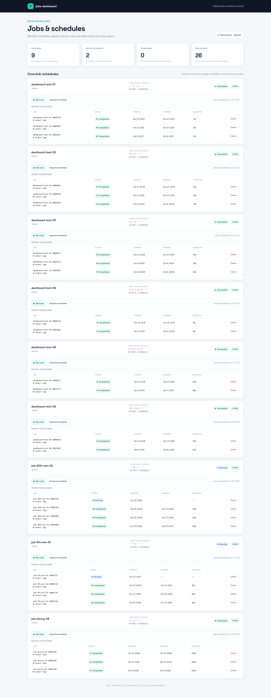

# jobs-dashboard

A small, self-hosted dashboard for monitoring and operating Kubernetes
`CronJob`s and their recent `Job` runs. The UI is server-rendered, with HTMX
handling background refreshes and actions.

<p align="center">
  
</p>

## Features

- View schedules, suspension state, and recent executions in one namespace.
- Run a `CronJob` immediately, suspend/resume it, and edit its raw cron
  expression.
- Inspect each Job's latest Pod logs and a read-only YAML manifest.
- Delete Jobs from the dashboard.
- Optionally protect every route with oauth2-proxy session validation.

## Requirements

- Go 1.24 or newer to build and test.
- Kubernetes 1.24 or newer, with a ServiceAccount and the permissions described
  in [Kubernetes deployment](#kubernetes-deployment), to run in a cluster.
- Docker, if you want to build the container image.

## Quick start

From the root of a checkout:

```sh
make check
make build
```

The application uses `rest.InClusterConfig`; it is designed to run inside
Kubernetes with a ServiceAccount token. A local `make run` is not provided
because a local process without Kubernetes in-cluster credentials cannot
connect to the API server.

Build the container image:

```sh
make image
```

The default image tag is `jobs-dashboard:local`. To choose another tag:

```sh
make image IMAGE=ghcr.io/your-org/jobs-dashboard:latest
```

## Release images

Pushing a semantic version tag such as `v1.2.3` triggers
[`publish.yaml`](./.github/workflows/publish.yaml). The workflow builds and
publishes multi-platform (`linux/amd64` and `linux/arm64`) images to
`ghcr.io/<owner>/<repository>` with these tags:

- `v1.2.3`
- `1.2.3`
- `1.2`
- `latest`

The workflow also creates a GitHub Release for the tag. Its generated release
notes summarize merged pull requests and changes since the previous release,
and include GitHub's compare link for viewing the full diff.

Create a release tag after merging the intended changes:

```sh
git tag v1.2.3
git push origin v1.2.3
```

The workflow uses the repository-provided `GITHUB_TOKEN`; ensure Actions have
permission to publish packages and create releases. Newly published GHCR
packages may need to be linked to the repository or have their visibility
changed in GitHub's package settings.

## Configuration

The Kubernetes Deployment imports environment variables from the ConfigMap
defined in [`k8s/manifest.yaml`](./k8s/manifest.yaml).

| Variable | Required | Default | Description |
| --- | --- | --- | --- |
| `NAMESPACE` | Yes | — | Namespace whose CronJobs and Jobs the dashboard operates on. |
| `ENDPOINT` | No | `/` | Dashboard endpoint value exposed through `/api/config`. |
| `MAX_JOBS` | No | `10` | Maximum number of recent Jobs shown for each CronJob. Must be a positive integer. |
| `OAUTH2_PROXY_ENABLED` | No | `false` | Enables oauth2-proxy authentication when set to `true`. |
| `OAUTH2_PROXY_AUTH_URL` | Yes | — | Internal oauth2-proxy `/oauth2/auth` endpoint. Required even while authentication is disabled. |
| `AUTH_EMAIL_DOMAIN` | Yes | — | Email domain allowed by the oauth2-proxy auth response. Required even while authentication is disabled. |
| `PUBLIC_URL` | Only when auth is enabled | `http://localhost:8080` | Public origin used to validate mutation request `Origin` headers. Non-local HTTP origins are rejected. |

Boolean values for `OAUTH2_PROXY_ENABLED` use Go's `strconv.ParseBool` formats
(`true`, `false`, `1`, `0`, `t`, `f`, and their accepted case variants). Invalid
values stop the application at startup.

### Authentication

Authentication is currently disabled by default and in the example Kubernetes
manifest. **When disabled, the dashboard has no user authentication.** Protect
it with trusted network controls and do not expose it directly to the public
internet.

To enable the retained oauth2-proxy integration:

1. Set `OAUTH2_PROXY_ENABLED: "true"`.
2. Set `PUBLIC_URL` to the dashboard's public HTTPS origin.
3. Configure oauth2-proxy to validate the Google Workspace domain, set
   `X-Auth-Request-Email`, and use the dashboard Service as its upstream.
4. Put OAuth client credentials and the cookie secret in a Kubernetes Secret or
   an external secret manager; never put secrets in this ConfigMap.
5. Route public traffic through oauth2-proxy only, terminate TLS, redirect
   HTTP to HTTPS, and keep the dashboard Service internal.

When authentication is enabled, the application forwards only the session
cookie to oauth2-proxy and verifies the returned email domain. It does not
trust client-supplied identity headers and fails closed if the auth service is
unavailable. The app also checks same-origin `Origin` headers on mutating
requests and sets security-related response headers.

When authentication is disabled, `PUBLIC_URL` may be omitted and the local
origin defaults to `http://localhost:8080`. Mutating requests still require a
matching `Origin`, so if the dashboard is served at a different origin, set
`PUBLIC_URL` to that origin (HTTPS is required except for localhost/loopback).

## Kubernetes deployment

Review and customize the image, namespace, public endpoint, and authentication
settings in [`k8s/manifest.yaml`](./k8s/manifest.yaml). The sample manifest
creates a Namespace, ConfigMap, ServiceAccount, RBAC resources, ClusterIP
Service, and Deployment.

Build and publish the image to a registry reachable by your cluster, then
update the Deployment image in the manifest. Apply it with:

```sh
kubectl apply -f k8s/manifest.yaml
kubectl -n jobs-dashboard rollout status deployment/jobs-dashboard
```

After changing ConfigMap values, restart the Deployment to refresh its
environment:

```sh
kubectl -n jobs-dashboard rollout restart deployment/jobs-dashboard
```

The sample uses a namespace-scoped `Role` and `RoleBinding` for the configured
namespace. If you change `NAMESPACE`, update the RBAC namespace and deployment
environment to match.

The dashboard Service is `ClusterIP`; the sample does not create an Ingress.
Provide ingress or a gateway separately, and do not expose the dashboard
publicly without authentication and appropriate TLS/network controls.

## HTTP API

| Method | Path | Description |
| --- | --- | --- |
| `GET` | `/` | Dashboard page. |
| `GET` | `/partials/dashboard` | Refreshed dashboard fragment. |
| `GET` | `/api/config` | Effective namespace, endpoint, and recent-job limit. |
| `GET` | `/api/cronjobs` | CronJobs and their recent Jobs in the configured namespace. |
| `GET` | `/api/cronjobs/{name}` | One CronJob and its recent Jobs. |
| `POST` | `/api/cronjobs/{name}/run` | Create a Job from a CronJob's template. |
| `PATCH` | `/api/cronjobs/{name}` | Change suspension state and/or raw cron schedule. |
| `GET` | `/api/jobs/{name}/logs` | Last 200 lines from the newest Pod owned by the Job, up to 128 KiB. |
| `GET` | `/api/jobs/{name}/manifest` | Job YAML without runtime status or server-managed metadata. |
| `DELETE` | `/api/jobs/{name}` | Delete a Job. |

The dashboard fetches logs and manifests only when their respective dropdowns
are opened. The logs endpoint reads the newest Pod owned by the selected Job
and includes logs from its containers.

For `PATCH /api/cronjobs/{name}`, send JSON such as:

```json
{"suspend": true, "schedule": "*/5 * * * *"}
```

The schedule is stored and displayed as-is; Kubernetes validates it when saved.
For form submissions, the endpoint also accepts URL-encoded fields named
`suspend` and `schedule`.

## Development

Run the common checks:

```sh
make check
```

Individual targets:

```sh
make test       # unit tests
make race       # tests with the Go race detector
make vet        # go vet
make fmt-check  # ensure Go files are gofmt-formatted
make build      # build ./bin/jobs-dashboard
make image      # build the container image
```

See [CONTRIBUTING.md](./CONTRIBUTING.md) for contribution guidelines.

## Security

Please do not report security vulnerabilities in public issues. See
[SECURITY.md](./SECURITY.md) for responsible disclosure guidance.

## License

This project is licensed under the [MIT License](./LICENSE).
